# Software Factory: Plan

> Status: **Draft for review**. Revised: the factory now runs as a **Claude Code plugin** (skills, slash commands, subagents and hooks) that you drive from Claude Code. A dashboard app is optional and can be added later.

## 1. Goal

An **AI agent software factory**, run by one person in Claude Code on a VM. You describe what you want built. The factory:
1. proposes the features,
2. lets you choose which ones to build,
3. writes specs and makes wireframes,
4. prepares the Azure infrastructure inputs (tfvars),
5. builds, tests and security-scans each feature on its own branch.

It deploys **only from `dev`** to Azure Kubernetes Service (AKS), using images in Azure Container Registry (ACR).

A human approves every important step. AI agents **never** create Azure resources, **never** merge to `dev`, and **never** promote to `main`.

## 2. Agreed decisions

| Area | Decision |
|---|---|
| How the factory runs | **Claude Code** on a **VM** (Linux recommended), single user. You run each stage with a slash command |
| What the factory is | A **Claude Code plugin** in this repo: slash commands, skills, subagents, hooks and small helper scripts |
| Orchestration | **You**, by running the next command. Each command checks that the earlier gates were approved before it starts |
| Claude access | Claude API key (billed per use), set on the VM |
| Models | Chosen **per subagent** to fit the work (see §5.1), not the strongest model everywhere |
| Dashboard | **Not in scope for now.** You follow the work in the Claude Code terminal. A dashboard app can be added later on top of the same plugin (§10, phase 9) |
| Approved docs | Approved specs, wireframes and plan reach `dev` as a `docs/...` PR that a human merges |
| Kubernetes manifests | **Plain YAML** in `deploy/` for now. The `dev` pipeline sets the image tag at deploy time. Kustomize can be adopted later if more environments are added |
| Pipeline credentials | **GitHub OIDC federated credential**. A human adds the non-secret IDs to the app repo's GitHub Actions variables. No client secret is stored. Agents never see them |
| Environments | **`dev` only** for now. tfvars are laid out per environment (`infra/dev.tfvars`) so more can be added later |
| Generated app stack | React (Vite + TypeScript) frontend, FastAPI backend |
| Hosting of generated apps | Azure native: AKS, images in ACR |
| Repos | One GitHub repo per generated app. The user creates the empty repo and gives its name to the factory |
| Clarifying questions | Before drafting specs, agents ask the user about preferences (DB, auth, naming, secrets, etc.) |
| Database | Chosen by the agent per use case, approved by the human |
| Auth | Entra ID or backend-managed auth, chosen per use case, approved by the human |
| Secrets | Key Vault / workload identity / etc., chosen per use case in the spec |
| Wireframes | Clickable HTML mockups, approved by the human **per feature** |
| Terraform | Modules are maintained **outside** the factory. The factory has **read-only** access to them and writes only **tfvars + a report** |
| Terraform modules | **Not built yet.** They will be built separately, outside the factory, before phase 3 (see §12) |
| Infra branch | tfvars and reports live on the `infra` branch of the app repo. `infra` never merges into `dev` or `main` |
| Infra apply | A human always runs `terraform apply` |
| Azure access for agents | **Read only** (Reader role), used to check that resources exist and match the tfvars |
| Feature order | The planner orders features by dependency. A foundation branch is built first |
| Tests | Test cases come from the acceptance criteria **before or during** development, not after |
| Loop limits | Max fix attempts per issue and revision rounds per gate. When a limit is reached, the agent stops and asks you |
| Rejections | You give feedback, and the agent revises and resubmits |
| Security tools | Semgrep, Bandit, pip-audit, npm audit, gitleaks, Trivy |
| Security | A dedicated security subagent: on every PR before the human merges to `dev`, and on the image before the ACR push |
| Feature branch testing | Agents test each feature branch **locally** with Docker Compose and local emulators |
| Human testing | Only on `dev`, deployed to AKS |
| Merge to `dev` | Always by a human |
| Promote to `main` | Always by a human. `main` deploys nothing (for now) |
| Build/deploy | Only `dev` builds images, pushes to ACR and deploys to AKS |
| Tracking | A repo manifest (`factory/plan.yaml`) is the source of truth. The Excel file is **generated** from it for humans |
| Artifacts | Specs, schemas and wireframes live in the app repo under `docs/` |
| GitHub | The factory sets up branch protection on `dev` and `main`. Its token can push branches and open PRs, but cannot merge |

## 3. End-to-end workflow

```mermaid
flowchart TD
    A["/factory-start owner/repo<br/>0. Project setup"] --> B["/requirements<br/>1. Business questions + summary"]
    B --> G0{{Gate 0: /approve requirements}}
    G0 --> C["/features<br/>2. Feature list"]
    C --> G1{{Gate 1: /approve features, with your selection}}
    G1 --> D["/tech-questions<br/>3. Technical questions"]
    D --> E["/spec<br/>4. Specs, DB schema, API, test cases"]
    E --> G2{{Gate 2: /approve specs}}
    G2 --> F["/wireframes F003<br/>5. Clickable HTML wireframes"]
    F --> G3{{Gate 3: /approve wireframes F003}}
    G3 --> H["/tfvars<br/>6. tfvars + infra report on infra branch"]
    H --> G4{{Gate 4: you review and run terraform apply}}
    G4 --> I["/verify-infra<br/>7. Read-only infra check"]
    I --> G5{{Gate 5: verification passed}}
    G5 --> J["/plan<br/>8. plan.yaml + Excel"]
    J --> G6{{Gate 6: /approve plan}}
    G6 --> K["/build F000, then /build F003 ...<br/>9. Foundation, then feature branches"]
    K --> L["/test F003<br/>10. Local tests + UI/UX review, issues, fixes"]
    L --> M["/security F003<br/>11. Security scan"]
    M --> N["/open-pr F003<br/>12. PR opened"]
    N --> G7{{Gate 7: you merge the PR to dev}}
    G7 --> O[13. dev pipeline: build, image scan,<br/>push to ACR, deploy to AKS]
    O --> P[14. You test on dev using the Excel]
    P -->|issues| L
    P --> G8{{Gate 8: you promote dev to main}}
```



### How gates work

Each stage command ends by telling you what it produced and where. You then do one of three things:

- **Approve:** type `/approve <gate>` (for example `/approve features` or `/approve wireframes F003`).
- **Reject with feedback:** type `/reject <gate>` followed by your feedback. The same subagent revises its work using your feedback and presents it again.
- **Ask questions or discuss:** just talk to Claude, then approve or reject.

Approvals are recorded in `factory/approvals.yaml` in the app repo. Every stage command checks this file first and refuses to run if an earlier gate has not been approved. For example, `/build F003` stops if the spec or wireframes for F003 are not approved.

Only you can approve. A hook records the approval when **you** type `/approve` (it reacts to your typed message, not to anything Claude does). A second hook blocks Claude from editing `approvals.yaml` itself. See §5, guardrails.

### Stage details

**0. Project setup** (`/factory-start owner/repo`, helper script, no AI judgement needed)
- You create an empty GitHub repo and run `/factory-start owner/repo`.
- A helper script:
  - clones the repo into the factory workspace,
  - creates the `main`, `dev` and `infra` branches,
  - applies branch protection (PRs required, human review required, no direct pushes to `dev`/`main`),
  - adds `CLAUDE.md`, the `docs/` and `factory/` folders, and the PR/issue templates.

**1. Requirements intake and understanding** (`/requirements`, Product Analyst subagent)
- You describe the app in the chat as free text, and can point to files. Saved as `docs/requirements.md`.
- The agent asks a few short **business** questions (not technical ones yet), for example:
  - Who are the users, and what roles do they have?
  - What main problem does the app solve?
  - What is clearly out of scope?
  - Is there an existing system or data to work with?
- It writes `docs/requirements-summary.md`: problem, users and roles, goals, scope and out-of-scope, assumptions.
- **Gate 0:** you approve the summary, or reject it with corrections. This stops the feature list from being built on guesses.

**2. Feature discovery** (`/features`, Product Analyst subagent)
- Proposes a full feature list in `docs/features.md`. Each feature has an ID, name, description, user value, priority (must/should/could), rough size, and dependencies.
- **Gate 1:** you say which features to build (for example `/approve features F001 F002 F004`). The rest are kept as a backlog for later.

**3. Clarifying questions** (`/tech-questions`, Architect subagent)
- Asks you about anything not yet known before proposing a design, for example:
  - DB preference
  - auth approach
  - naming conventions
  - Azure region / subscription / resource-group naming
  - secrets approach
  - expected users and load
  - data residency / compliance
  - integrations
- Answers are saved in `docs/decisions.md` and reused for every later feature.

**4. Specs** (`/spec`, Architect subagent + QA subagent)
- **System level, once per app:**
  - `docs/architecture.md`: components, chosen DB with the reasons, auth design, secrets design, AKS layout, environments.
  - `docs/azure-components.md`: the list of Azure resources needed, mapped to the external Terraform modules.
- **Per feature:** `docs/specs/<feature-id>.md`, containing:
  - scope and user stories,
  - UI screens and flows (React),
  - API endpoints (FastAPI), with the contract in `docs/api/openapi.yaml`,
  - DB schema changes (`docs/db/`), plus a migration plan (Alembic),
  - acceptance criteria,
  - **test cases** derived from the acceptance criteria (QA subagent): unit, API and end-to-end,
  - non-functional notes (security, performance),
  - what a human must test on `dev`.
- **Gate 2:** you approve the specs, DB schemas and other components, or reject them with feedback.

**5. Wireframes** (`/wireframes <feature-id>`, UX Designer subagent)
- Clickable HTML mockups for every screen in the feature, in `docs/wireframes/<feature-id>/`. A shared layout (navigation, header, styles) is reused across features.
- The command tells you how to open them in a browser (through your SSH tunnel to the VM).
- **Gate 3 (per feature):** you approve or reject each feature's wireframes separately. A rejection only sends that feature back; approved features move on.

**6. Infrastructure inputs** (`/tfvars`, Infra subagent)
- Reads the external Terraform modules (read-only).
- Writes to the `infra` branch:
  - `infra/<env>.tfvars`
  - `infra/report.md`: what will be created and why, mapped to the spec, with cost notes, naming, and identities/roles needed.
- **Gate 4:** you review it and run `terraform plan/apply` yourself, using the external modules.

**7. Infra verification** (`/verify-infra`, Infra Verifier subagent, read-only Azure access)
- Checks that every expected resource exists and matches the tfvars: names, SKUs, region, ACR/AKS link, Key Vault, DB, identities.
- Writes `infra/verification-report.md`.
- **Gate 5:** verification has passed. If it fails, the report lists what is missing for you to fix.

**8. Build plan** (`/plan`, Planner subagent)
- Creates `factory/plan.yaml` (see §6):
  - the build order based on dependencies,
  - the branch name for each feature,
  - the planned PRs,
  - what each PR covers,
  - human test steps.
- A helper script generates `factory/plan.xlsx` from it.
- **Gate 6:** you approve the plan.

**9. Development** (`/build <feature-id>`, Developer subagent)
- The **foundation branch** (`/build F000`) is built first:
  - project skeleton,
  - auth wiring,
  - base layout,
  - DB setup and migration framework,
  - Docker Compose with emulators,
  - Kubernetes manifests,
  - GitHub Actions pipelines,
  - CI checks.
- Then each feature gets its own branch (`feature/<id>-<slug>`), in its own git worktree, in dependency order.
- To build independent features in parallel, open one Claude Code session per feature and run `/build` in each. The command refuses a feature whose dependencies are not built yet.
- Developers first implement against the test cases written in stage 4, then add any extra tests they need.
- DB migrations are ordered by the planner to avoid conflicts.

**10. Local testing** (`/test <feature-id>`, Tester subagent + UI/UX Tester subagent)
- For the branch:
  1. Start a clean Docker Compose stack.
  2. Run migrations and load seed data.
  3. Run unit, API and end-to-end tests (Playwright).
  4. Shut the stack down.
- The UI/UX tester compares the running UI against the approved wireframes and checks usability and accessibility.
- Failures become **GitHub Issues** linked to the feature. The Developer subagent fixes them on the same branch, then the tests run again.
- Loop limits apply (see §8).

**11. Security scan** (`/security <feature-id>`, Security subagent)
- Runs on the branch before its PR is ready for review:
  - SAST (Semgrep, Bandit),
  - dependency audit (pip-audit, npm audit),
  - secret scanning (gitleaks),
  - IaC/K8s manifest checks.
- Findings become issues. High and critical findings block the PR from being opened.

**12. Pull request** (`/open-pr <feature-id>`)
- The PR description is generated from `plan.yaml` and includes:
  - the features covered,
  - the linked spec,
  - test results,
  - the security scan summary,
  - human test steps.
- **Gate 7:** you review and merge to `dev` in GitHub.

**13. Dev pipeline** (GitHub Actions, not an AI agent)
- On every merge to `dev`:
  1. Build images.
  2. Scan the images (Trivy).
  3. Push to ACR.
  4. Deploy to AKS.
- The pipeline authenticates to Azure using values a **human** adds to the repo's GitHub Actions settings:
  - Authentication uses a **GitHub OIDC federated credential** on an Azure identity (created by the human's Terraform), trusted only for the `dev` branch of the app repo. No client secret or password is stored.
  - **Variables** (not sensitive): `AZURE_CLIENT_ID`, `AZURE_TENANT_ID`, `AZURE_SUBSCRIPTION_ID`, ACR name, AKS cluster name, resource group.
  - The identity needs only: AcrPush on the ACR and deploy rights on the AKS cluster/namespace.
- The infra report lists exactly which variables, roles and federated credential settings are required. AI agents never hold these credentials.

**14. Human testing on `dev`**
- You test using the Excel file and record the results.
- Problems become issues, which go back to stage 10.
- **Gate 8:** you promote `dev` to `main` when ready.

### Adding features later

New features re-enter at **stage 2** (`/features` again), or at stage 4 if picked from the backlog:
1. The Architect subagent reads the existing specs, `docs/decisions.md` and the current schema.
2. It produces an **impact analysis**: which DB changes, APIs, screens and Azure components are affected.
3. It writes new or updated specs.
4. The flow continues from there. Only changed infra goes through stages 6–7 again.

## 4. Factory architecture

```
┌──────────────────────────── Factory VM ────────────────────────────┐
│                                                                    │
│  You ── SSH ──> Claude Code (terminal)                             │
│                   │                                                │
│                   │ loads                                          │
│                   ▼                                                │
│  Factory plugin (this repo, factory-plugin/)                       │
│   • commands/   slash commands, one per stage (/features, /spec…)  │
│   • agents/     subagents, one per role, each with model + tools   │
│   • skills/     how to do each task, output formats, templates     │
│   • hooks/      guardrails, approval recording, audit log          │
│   • scripts/    helpers: repo bootstrap, gate checks, Excel        │
│                   │                                                │
│                   │ works in                                       │
│                   ▼                                                │
│  Workspaces: ~/factory-workspaces/<repo>/ (clone + git worktrees)  │
│  Docker: per-branch Compose stacks for local testing               │
└───────────┬──────────────────┬───────────────────┬─────────────────┘
            │                  │                   │
     Claude API          GitHub (token:       Azure (Reader-only
                         push branches,       service principal)
                         PRs, issues;         + Terraform modules repo
                         no merge)            (read-only)
```

**Factory secrets (on the VM only)**
- Claude API key, GitHub token and Azure Reader credentials are kept in environment variables or a protected file on the VM.
- They are never committed and never passed to generated apps.

### 4.1 Execution model: how the factory runs

The factory is made of these pieces:

| Piece | What it is | Example |
|---|---|---|
| **Slash command** | What you type to run a stage. It checks the gates, then hands the work to the right subagent with the right skill | `/spec` checks Gate 1 is approved, then starts the Architect |
| **Subagent** | A Claude helper with one role: its own instructions, model and allowed tools | Product Analyst on Sonnet, allowed to read and write docs only |
| **Skill** | Written instructions for one task: steps, output format, templates, examples. Markdown, editable without code changes | `feature-discovery`: how to break a use case into features, and the exact `features.md` format |
| **Tool** | Something Claude can do | Write a file, run `git`, open a PR, ask you a question |
| **Hook** | A script Claude Code runs automatically at set moments, outside Claude's control | Blocks `terraform apply` before it runs; records your `/approve` |
| **Helper script** | Ordinary code for steps that must be exact, not judged by AI | Repo bootstrap, gate checks, Excel generation from `plan.yaml` |

In short: **you run a command; the command checks the gates and hands the work to a subagent; the subagent follows a skill and uses tools; hooks enforce the rules throughout.**

**Tools used**
1. **Built-in Claude Code tools:** read/write/edit files, search, shell commands (git, Docker, tests), and asking you questions in the chat.
2. **Command-line tools on the VM:** `gh` (GitHub), `az` (Azure, read-only identity), Playwright, the security scanners.
3. **MCP servers** where they help: for example a read-only Azure MCP server for the Infra Verifier.

The custom factory tools from the earlier app design (`ask_user`, `submit_for_approval`, `record_features`, `record_plan`, `report_progress`) are not needed: Claude asks questions directly in the chat, approvals go through `/approve` and `/reject`, and structured data is written straight to `features.md` and `plan.yaml`.

**Where things live**
- Commands, subagents, skills, hooks and helper scripts live in the **factory plugin** in this repo (`factory-plugin/`). The VM's Claude Code loads this plugin.
- You run Claude Code inside the **app repo workspace** (or a feature worktree), so all output lands in the app repo.

**Stage → command → subagent → skill**

| Stage | Command | Subagent (model) | Skill(s) |
|---|---|---|---|
| 0. Project setup | `/factory-start owner/repo` | None (helper script) | — |
| 1. Requirements | `/requirements` | Product Analyst (Sonnet) | `requirements-analysis` |
| 2. Feature list | `/features` | Product Analyst (Sonnet) | `feature-discovery` |
| 3. Tech questions | `/tech-questions` | Architect (Opus) | `clarify-tech` |
| 4. Specs + test cases | `/spec` | Architect (Opus), QA (Sonnet) | `write-spec`, `db-schema`, `api-contract`, `test-cases-from-criteria` |
| 5. Wireframes | `/wireframes <id>` | UX Designer (Sonnet) | `html-wireframes` |
| 6. tfvars | `/tfvars` | Infra (Sonnet) | `tfvars-from-modules` |
| 7. Infra check | `/verify-infra` | Infra Verifier (Haiku) | `verify-azure` |
| 8. Build plan | `/plan` | Planner (Sonnet) | `build-plan` |
| 9. Development | `/build <id>` | Developer (Opus) | `implement-feature`, `fix-issue` |
| 10. Testing | `/test <id>` | Tester (Haiku), UI/UX Tester (Sonnet) | `local-test`, `ui-review` |
| 11. Security | `/security <id>` | Security (Sonnet) | `security-scan` |
| 12. Pull request | `/open-pr <id>` | Developer (Opus) | `open-pr` |
| Any time | `/status`, `/approve`, `/reject` | None | — |

**Example: the first stages**
1. You create an empty repo on GitHub, open Claude Code on the VM, and type `/factory-start acme/expenses`. The helper script sets up the repo and branches.
2. You type `/requirements` and describe the app. The Product Analyst asks a few business questions in the chat, then writes `docs/requirements-summary.md` and asks you to review it.
3. You read it and type `/approve requirements` (or `/reject requirements` plus what's wrong).
4. You type `/features`. The Product Analyst writes `docs/features.md`.
5. You type `/approve features F001 F002 F004`. The rest go to the backlog. Next is `/tech-questions`.

At any point, `/status` shows which gates are approved and what the next command is.

## 5. Agent roles and permissions

| Subagent | Stage(s) | Can do | Cannot do |
|---|---|---|---|
| Product Analyst | 1, 2 | Ask business questions; write the requirements summary and the feature list | Touch code, infra or GitHub settings |
| Architect | 3, 4, later features | Ask questions; write architecture, specs, schemas, OpenAPI | Write app code; access Azure |
| QA (test author) | 4 | Write test cases from acceptance criteria | Change specs |
| UX Designer | 5 | Write HTML mockups in `docs/wireframes/` | Write app code |
| Infra | 6 | Read Terraform modules; write tfvars and a report to the `infra` branch | Run `terraform apply/plan` against Azure; any Azure write; edit modules |
| Infra Verifier | 7 | Read-only Azure queries; write a verification report | Any Azure write |
| Planner | 8 | Write `plan.yaml`; generate the Excel | Write app code |
| Developer | 9, 12, fixes | Write code on its own feature branch/worktree; push that branch; open PRs; comment on issues | Push to or merge into `dev`/`main`/`infra`; access Azure |
| Tester | 10 | Run Docker Compose and tests locally; file issues | Change app code |
| UI/UX Tester | 10 | Drive the UI with Playwright; compare against wireframes; file issues | Change app code |
| Security | 11 | Run scanners; file issues; record security status | Change app code; dismiss its own findings |

### 5.1 Model per subagent (starting defaults, changeable)

| Subagent | Model | Why |
|---|---|---|
| Architect | Claude Opus 5.5 | Hardest reasoning: design, DB choice, auth and impact analysis |
| Developer | Claude Opus 5.5 | Most code quality per task; fewer fix loops |
| Product Analyst | Claude Sonnet 5.5 | Structured brainstorming |
| QA (test author) | Claude Sonnet 5.5 | Turning acceptance criteria into tests |
| UX Designer | Claude Sonnet 5.5 | HTML mockups |
| Infra (tfvars) | Claude Sonnet 5.5 | Mapping the spec to module inputs |
| Planner | Claude Sonnet 5.5 | Dependency ordering and the manifest |
| Security | Claude Sonnet 5.5 | Interpreting scanner output and judging severity |
| UI/UX Tester | Claude Sonnet 5.5 | Screenshot and UI judgement |
| Tester | Claude Haiku 5.5 | Mostly running tests and reporting results |
| Infra Verifier | Claude Haiku 5.5 | Read-only checks against a known list |

The model is set in each subagent's definition file. Watch cost with `/cost` in Claude Code and the usage page in the Claude Console. Move a subagent up a tier if it causes repeated failures, or down if it does fine.

### Guardrails (layered)

1. **Identity level, which is the real enforcement:**
   - The Azure service principal has only the **Reader** role.
   - The Terraform modules repo is read-only.
   - The GitHub token cannot bypass branch protection.
   - `dev`/`main` require a human review to merge.
2. **Plugin hooks** (run by Claude Code, outside the model's control):
   - **Guardrail hook** before every tool call: blocks `terraform apply/plan/destroy`, `az` write commands, `kubectl`/`helm` changes, pushes and merges to `dev`/`main`/`infra` (except the Infra subagent pushing to `infra`), force pushes, `gh pr merge`, and file writes outside the workspace. These are the rules already written and tested in phase 0, reused as a hook script.
   - **Approval hook:** records an approval only when **you** type `/approve`, and blocks Claude from editing `factory/approvals.yaml`.
   - **Audit hook:** appends every tool call and every blocked attempt to a log file on the VM.
3. **Per-subagent tool lists:** each subagent gets only the tools it needs.
4. **Working folder:** each session works inside the app repo workspace or one feature worktree.

## 6. App repo layout and branches

```
<app-repo>/
├── CLAUDE.md                     # conventions all agents follow
├── frontend/                     # React + Vite + TypeScript
├── backend/                      # FastAPI (+ Alembic migrations)
├── deploy/                       # Kubernetes manifests (plain YAML)
├── docker-compose.yml            # local stack + emulators
├── tests/e2e/                    # Playwright end-to-end tests
├── .github/workflows/            # CI checks; dev build→scan→ACR→AKS pipeline
├── docs/
│   ├── requirements.md
│   ├── requirements-summary.md   # approved at Gate 0
│   ├── decisions.md              # answers to clarifying questions
│   ├── features.md               # proposed + selected + backlog
│   ├── architecture.md
│   ├── azure-components.md
│   ├── specs/<feature-id>.md
│   ├── db/                       # schema docs / ERD
│   ├── api/openapi.yaml
│   └── wireframes/<feature-id>/  # clickable HTML mockups
└── factory/
    ├── approvals.yaml            # gate approvals, written only by the approval hook
    ├── plan.yaml                 # SOURCE OF TRUTH for features/branches/PRs
    ├── plan.xlsx                 # GENERATED from plan.yaml — do not edit
    └── reports/                  # test, UI/UX and security reports
```

**Branches**

| Branch | Purpose | Who writes | Merged by |
|---|---|---|---|
| `main` | Released code; deploys nothing (for now) | No one directly | Human (from `dev`) |
| `dev` | Integration; **only branch that builds/pushes to ACR/deploys to AKS** | No one directly | Human (from PRs) |
| `infra` | tfvars + infra reports. Never merged | Infra subagent | — |
| `feature/000-foundation` | Skeleton, CI, Compose, manifests | Developer subagent | Human → `dev` |
| `feature/<id>-<slug>` | One per feature | Developer subagent | Human → `dev` |
| `docs/<stage>-<n>` | Approved docs (specs, wireframes, plan), delivered as a PR | Factory commands | Human → `dev` |

**`plan.yaml` example entry**

```yaml
- id: F003
  feature: User login
  branch: feature/F003-user-login
  pr: 12
  depends_on: [F000]
  spec: docs/specs/F003.md
  status: in-review          # planned | building | testing | security | in-review | merged | verified
  agent_tests: passed
  security: passed
  fix_attempts: 1
  covers: "Login page, JWT session, password reset email"
  human_test_steps: "1) Log in with valid creds 2) Invalid creds show error 3) Reset password email arrives"
  expected_result: "..."
  human_result: ""           # filled in after testing on dev
```

**Excel columns (generated):**
- #, Feature ID, Feature, Branch, PR #, PR link, Depends on, Status
- What the PR covers, Agent test result, Security result, Merged to dev (date)
- Human test steps, Expected result, Human test result, Notes

## 7. Local testing environment

Agents test each branch on their own isolated Docker Compose stack, using local stand-ins for Azure services:

| Azure | Local stand-in |
|---|---|
| Azure Database for PostgreSQL | PostgreSQL container |
| Azure SQL | SQL Server container |
| Cosmos DB | Cosmos DB emulator |
| Blob / Queue / Table Storage | Azurite |
| Key Vault | `.env` with fake secrets |
| Entra ID | Mock login (or a test tenant if available) |
| AKS | Containers in Docker |

Requirements on the factory VM:
- Docker Engine,
- enough RAM: roughly 8–16 GB free per full stack,
- you decide how many `/test` sessions to run at once.

The emulators don't behave exactly like Azure, so the final check is human testing on `dev`.

## 8. Loop limits and budgets

| Limit | Default | How it's enforced | On breach |
|---|---|---|---|
| Fix attempts per issue | 3 | Counted in `plan.yaml`; `/test` checks it | Stops and asks you |
| Revision rounds per gate | 3 | Counted in `approvals.yaml` | Stops and summarizes the disagreement |
| Turns per subagent task | Per role | Stated in the skill; you can interrupt any time | Stops and reports |
| Overall spend | Set by you | **Spend limit on the Claude Console workspace** used by the factory's API key | API calls stop until you raise it |

## 9. Visibility (no dashboard for now)

- **Live:** you watch each command run in the Claude Code terminal, including every file edit, command and blocked action.
- **`/status`:** a summary of the project: which gates are approved, each feature's status from `plan.yaml`, open issues, and the next command to run.
- **Audit log:** the audit hook writes every tool call and blocked attempt to a log file on the VM (one per app repo).
- **History:** Claude Code keeps each session's transcript; you can resume an earlier session.
- **Cost:** `/cost` per session, and the Claude Console usage page overall.
- **Excel:** `factory/plan.xlsx` for your testing on `dev`.

A dashboard app (live feed across sessions, cost per feature, approval inbox) can be added later as phase 9 without changing the plugin.

## 10. Phased build of the factory

| Phase | Scope | Outcome |
|---|---|---|
| **0. App skeleton** ✅ done | FastAPI + React dashboard shell, Agent SDK runtime, guardrail rules with tests, plugin folder. **Kept for the optional phase 9.** Its guardrail rules and plugin folder are reused from phase 1 | Guardrail rules proven; plugin format proven |
| **1. Plugin foundation + document stages** | Plugin layout; guardrail, approval and audit hooks; `/factory-start` (repo bootstrap + branch protection); `/status`, `/approve`, `/reject`; `/requirements`, `/features`, `/tech-questions`, `/spec` with their subagents and skills | Approved requirements, feature list and specs in an app repo |
| **2. Wireframes** | `/wireframes`, UX Designer subagent and skill, per-feature approval | Approved clickable wireframes |
| **3. Infra** | `/tfvars`, `/verify-infra`, read-only module access, Azure Reader access | tfvars + report on `infra`; verified Azure environment |
| **4. Planning** | `/plan`, `plan.yaml`, Excel helper script | Approved build plan + Excel |
| **5. Build + local test** | `/build`, `/test`, foundation branch, worktrees, Compose stacks, Tester + UI/UX Tester, issue/fix loop with limits | Tested feature branches |
| **6. Security + PRs** | `/security`, `/open-pr` | PRs ready for you to merge |
| **7. Dev pipeline** | GitHub Actions template: build → image scan → ACR → AKS (manifests from foundation) | Auto-deploy from `dev` |
| **8. Later features + hardening** | New-feature and backlog flow with impact analysis; skill tuning from real use | Full lifecycle |
| **9. Dashboard (optional)** | Runs the same plugin through the Agent SDK, using the phase 0 app: live feed, approval inbox, cost per feature | Only if running by hand becomes a burden |

**Suggested v1 milestone:** phases 1–4, which take a project from requirements to an approved, infra-verified build plan. Phases 5–7 complete the build loop.

## 11. Open decisions

1. **Approval hook:** confirm in phase 1 that Claude Code's prompt hook sees `/approve` exactly as you typed it, so approvals are recorded by the hook and not by the model. If it doesn't, approvals will go through a small helper script you run yourself instead.
2. **GitHub access on the VM:** a GitHub token for `gh`, with permission to create branches, set branch protection, push feature branches and open PRs, but not to bypass protection. Needed from phase 1.

## 12. Dependency: Terraform modules (built outside the factory)

The modules don't exist yet. They are built and owned outside the factory, but the factory depends on them from **phase 3** onwards. Phases 1–2 can proceed without them.

For the Infra subagent to write correct tfvars and the Infra Verifier to check results, each module should provide:
- a **README** describing what it creates and its naming rules,
- **`variables.tf`** with a description, type, and validation where possible for every input,
- **`outputs.tf`** with the resource names/IDs the verifier can check,
- **version tags**, so the tfvars reference a known module version.

Modules the generated apps are likely to need (to be confirmed when building them):
- Resource group, networking (VNet/subnets)
- ACR
- AKS (with workload identity and OIDC issuer enabled)
- Key Vault
- Database: PostgreSQL Flexible Server / Azure SQL / Cosmos DB (one module each, chosen per app)
- Storage account
- Managed identities + role assignments (including the GitHub OIDC pipeline identity)
- Log Analytics / monitoring

**Factory access:** the factory gets **read-only** access to the modules repo (read-only GitHub token or read-only clone). It never edits the modules.

## 13. Factory VM notes

- Linux VM with Docker Engine, Claude Code, `git`, `gh`, `az`, Node and Python. Start around 8 vCPU / 32 GB RAM and scale up as needed.
- You connect over SSH. There's no web UI to expose (until the optional dashboard).
- Factory secrets (Claude API key, GitHub token, Azure Reader credentials) live on the VM only, in environment variables or a protected file, or in Azure Key Vault read by the VM's identity.
- Keep the VM disk snapshotted or back up the workspace folder and audit logs.
