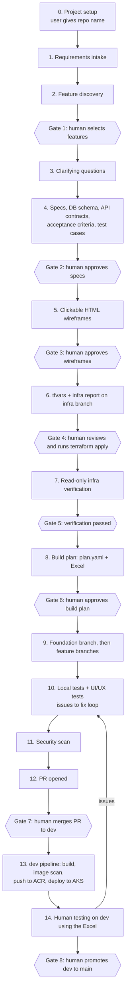

# Software Factory: Plan

> Status: **Draft for review**. No code yet. This document captures the agreed design and the decisions still open.

## 1. Goal

A locally run **AI agent software factory**. You enter what you want built. The factory:
1. proposes the features,
2. lets you choose which ones to build,
3. writes specs and makes wireframes,
4. prepares the Azure infrastructure inputs (tfvars),
5. builds, tests and security-scans each feature on its own branch.

It deploys **only from `dev`** to Azure Kubernetes Service (AKS), using images in Azure Container Registry (ACR).

A human approves every important step. AI agents **never** create Azure resources, **never** merge to `dev`, and **never** promote to `main`.

## 2. Agreed decisions

| Area | Decision |
|---|---|
| Factory runtime | Local app, single user |
| Factory stack | React (Vite + TypeScript) frontend, FastAPI backend |
| Agent engine | **Claude Agent SDK (Python)**, which is Claude Code as a library, called from the FastAPI backend, using the Claude API directly |
| Generated app stack | React (Vite + TypeScript) frontend, FastAPI backend |
| Hosting of generated apps | Azure native: AKS, images in ACR |
| Repos | One GitHub repo per generated app. The user creates the empty repo and gives its name to the factory |
| Clarifying questions | Before drafting specs, agents ask the user about preferences (DB, auth, naming, secrets, etc.) |
| Database | Chosen by the agent per use case, approved by the human |
| Auth | Entra ID or backend-managed auth, chosen per use case, approved by the human |
| Secrets | Key Vault / workload identity / etc., chosen per use case in the spec |
| Wireframes | Clickable HTML mockups, approved by the human |
| Terraform | Modules are maintained **outside** the factory. The factory has **read-only** access to them and writes only **tfvars + a report** |
| Infra branch | tfvars and reports live on the `infra` branch of the app repo. `infra` never merges into `dev` or `main` |
| Infra apply | A human always runs `terraform apply` |
| Azure access for agents | **Read only** (Reader role), used to check that resources exist and match the tfvars |
| Feature order | The planner orders features by dependency. A foundation branch is built first |
| Tests | Test cases come from the acceptance criteria **before or during** development, not after |
| Loop limits | Max fix attempts and budgets. When a limit is reached, the agent escalates to the human |
| Rejections | The human gives feedback, and the agent revises and resubmits |
| Security | A dedicated security scanning agent: on every PR before the human merges to `dev`, and on the image before the ACR push |
| Feature branch testing | Agents test each feature branch **locally** with Docker Compose and local emulators |
| Human testing | Only on `dev`, deployed to AKS |
| Merge to `dev` | Always by a human |
| Promote to `main` | Always by a human. `main` deploys nothing (for now) |
| Build/deploy | Only `dev` builds images, pushes to ACR and deploys to AKS |
| Tracking | A repo manifest (`factory/plan.yaml`) is the source of truth. The Excel file is **generated** from it for humans |
| Artifacts | Specs, schemas and wireframes live in the app repo under `docs/` |
| GitHub | The factory sets up branch protection on `dev` and `main`. Its token can push branches and open PRs, but cannot merge |
| Observability | A dashboard shows each stage and what every agent is doing |

## 3. End-to-end workflow



Every gate has two outcomes: **Approve** or **Reject with feedback**. On rejection, the agent that owns that stage resumes its session with the feedback, revises, and resubmits.

### Stage details

**0. Project setup**
- The user creates an empty GitHub repo and enters its name in the factory.
- The factory bootstraps it:
  - creates the `main`, `dev` and `infra` branches,
  - applies branch protection (PRs required, human review required, no direct pushes to `dev`/`main`),
  - adds `CLAUDE.md`, the `docs/` and `factory/` folders, and the PR/issue templates.

**1. Requirements intake**
- The user describes the app in the factory UI as free text, optionally with attachments.
- Saved as `docs/requirements.md`.

**2. Feature discovery** (Product Analyst agent)
- Proposes a full feature list. Each feature has an ID, name, description, user value, priority (must/should/could), rough size, and dependencies.
- **Gate 1:** the user picks which features to build. Unselected features are kept as a backlog for later.

**3. Clarifying questions** (Architect agent)
- Asks the user about anything not yet known before proposing a design, for example:
  - DB preference
  - auth approach
  - naming conventions
  - Azure region / subscription / resource-group naming
  - secrets approach
  - expected users and load
  - data residency / compliance
  - integrations
- Answers are saved in `docs/decisions.md` and reused for every later feature.

**4. Specs** (Architect agent + QA agent)
- **System level, once per app:**
  - `docs/architecture.md`: components, chosen DB with the reasons, auth design, secrets design, AKS layout, environments.
  - `docs/azure-components.md`: the list of Azure resources needed, mapped to the external Terraform modules.
- **Per feature:** `docs/specs/<feature-id>.md`, containing:
  - scope and user stories,
  - UI screens and flows (React),
  - API endpoints (FastAPI), with the contract in `docs/api/openapi.yaml`,
  - DB schema changes (`docs/db/`), plus a migration plan (Alembic),
  - acceptance criteria,
  - **test cases** derived from the acceptance criteria (QA agent): unit, API and end-to-end,
  - non-functional notes (security, performance),
  - what a human must test on `dev`.
- **Gate 2:** the human approves the specs, DB schemas and other components, or rejects them with feedback.

**5. Wireframes** (UX agent)
- Clickable HTML mockups for every screen in the approved features, in `docs/wireframes/`, viewable in the factory UI.
- **Gate 3:** the human approves, or rejects with feedback.

**6. Infrastructure inputs** (Infra agent)
- Reads the external Terraform modules (read-only).
- Writes to the `infra` branch:
  - `infra/<env>.tfvars`
  - `infra/report.md`: what will be created and why, mapped to the spec, with cost notes, naming, and identities/roles needed.
- **Gate 4:** the human reviews it and runs `terraform plan/apply` themselves, using the external modules.

**7. Infra verification** (Infra Verifier agent, read-only Azure access)
- Checks that every expected resource exists and matches the tfvars: names, SKUs, region, ACR/AKS link, Key Vault, DB, identities.
- Writes `infra/verification-report.md`.
- **Gate 5:** verification has passed. If it fails, the report lists what is missing for the human to fix.

**8. Build plan** (Planner agent)
- Creates `factory/plan.yaml` (see §6):
  - the build order based on dependencies,
  - the branch name for each feature,
  - the planned PRs,
  - what each PR covers,
  - human test steps.
- Generates `factory/plan.xlsx` from it.
- **Gate 6:** the human approves the plan.

**9. Development** (Developer agents)
- The **foundation branch** is built first:
  - project skeleton,
  - auth wiring,
  - base layout,
  - DB setup and migration framework,
  - Docker Compose with emulators,
  - Kubernetes manifests,
  - GitHub Actions pipelines,
  - CI checks.
- Then each feature gets its own branch (`feature/<id>-<slug>`), in its own git worktree, in dependency order. Independent features can be built in parallel.
- Developers first implement against the test cases written in stage 4, then add any extra tests they need.
- DB migrations are serialized by the planner to avoid conflicts.

**10. Local testing** (Tester agent + UI/UX Tester agent)
- For each branch:
  1. Start a clean Docker Compose stack.
  2. Run migrations and load seed data.
  3. Run unit, API and end-to-end tests (Playwright).
  4. Shut the stack down.
- The UI/UX tester compares the running UI against the approved wireframes and checks usability and accessibility.
- Failures become **GitHub Issues** linked to the feature. The Developer agent picks them up and fixes them on the same branch.
- Loop limits apply (see §8).

**11. Security scan** (Security agent)
- Runs on each branch before its PR is ready for review:
  - SAST (e.g. Semgrep, Bandit),
  - dependency audit (pip-audit, npm audit),
  - secret scanning (gitleaks),
  - IaC/K8s manifest checks.
- Findings become issues. High and critical findings block the PR from being marked ready.

**12. Pull request**
- The PR description is generated from `plan.yaml` and includes:
  - the features covered,
  - the linked spec,
  - test results,
  - the security scan summary,
  - human test steps.
- **Gate 7:** a human reviews and merges to `dev`.

**13. Dev pipeline** (GitHub Actions, not an AI agent)
- On every merge to `dev`:
  1. Build images.
  2. Scan the images (e.g. Trivy).
  3. Push to ACR.
  4. Deploy to AKS.
- The pipeline uses an Azure identity (GitHub OIDC federated credential) that a **human** creates via Terraform. AI agents never hold these credentials.

**14. Human testing on `dev`**
- The human tests using the Excel file and records the results.
- Problems become issues, which go back to stage 10.
- **Gate 8:** a human promotes `dev` to `main` when ready.

### Adding features later

New features re-enter at **stage 2** (or stage 4, if picked from the backlog):
1. The Architect agent reads the existing specs, `docs/decisions.md` and the current schema.
2. It produces an **impact analysis**: which DB changes, APIs, screens and Azure components are affected.
3. It writes new or updated specs.
4. The flow continues from there. Only changed infra goes through stages 6–7 again.

## 4. Factory architecture

```
┌──────────────────────── Factory (local machine) ─────────────────────────┐
│                                                                          │
│  React UI (Vite+TS)                                                      │
│   • Requirements intake  • Feature picker  • Approval inbox              │
│   • Spec / wireframe viewer  • Excel download  • Observability dashboard │
│            │  REST + WebSocket/SSE (live events)                         │
│  FastAPI backend                                                         │
│   • Orchestrator: per-project stage state machine + approval gates       │
│   • Job runner: queue, concurrency cap, budgets, loop limits             │
│   • Agent runtime: Claude Agent SDK sessions (one per agent task)        │
│   • Event bus: every agent message / tool call → DB + dashboard          │
│   • Excel generator (from plan.yaml)                                     │
│   • SQLite: projects, stages, approvals, feedback, events, costs         │
│            │                                                             │
│  Workspaces: ~/factory-workspaces/<project>/  (clone + git worktrees)    │
│  Docker: per-branch Compose stacks for local testing                     │
└───────────┬──────────────────┬───────────────────┬───────────────────────┘
            │                  │                   │
     Claude API          GitHub (token:       Azure (Reader-only
                         push branches,       service principal)
                         PRs, issues;         + Terraform modules repo
                         no merge)            (read-only)
```

**How agents run**
- Each agent task is a Claude Agent SDK session with:
  - a role prompt and stage skills,
  - an allowed tool list,
  - a working directory limited to its worktree,
  - MCP servers it is allowed to use,
  - hooks for guardrails and event logging.
- Sessions are stored so the agent can **resume with human feedback** after a rejection.
- The orchestrator, not the agents, decides stage transitions, enforces gates, and starts the next agent.

**Factory secrets (local)**
- Claude API key, GitHub token and Azure Reader credentials are kept in a local `.env` or the OS keychain.
- They are never committed and never passed to generated apps.

## 5. Agent roles and permissions

| Agent | Stage(s) | Can do | Cannot do |
|---|---|---|---|
| Product Analyst | 2 | Read requirements; write the feature list | Touch code, infra or GitHub settings |
| Architect | 3, 4, later features | Ask the user questions; write architecture, specs, schemas, OpenAPI | Write app code; access Azure |
| QA (test author) | 4 | Write test cases from acceptance criteria | Change specs |
| UX Designer | 5 | Write HTML mockups in `docs/wireframes/` | Write app code |
| Infra | 6 | Read Terraform modules; write tfvars and a report to the `infra` branch | Run `terraform apply/plan` against Azure; any Azure write; edit modules |
| Infra Verifier | 7 | Read-only Azure queries; write a verification report | Any Azure write |
| Planner | 8 | Write `plan.yaml`; generate the Excel | Write app code |
| Developer | 9, fixes | Write code on its own feature branch/worktree; push that branch; open PRs; comment on issues | Push to or merge into `dev`/`main`/`infra`; access Azure |
| Tester | 10 | Run Docker Compose and tests locally; file issues | Change app code |
| UI/UX Tester | 10 | Drive the UI with Playwright; compare against wireframes; file issues | Change app code |
| Security | 11 | Run scanners; file issues; mark PR security status | Change app code; dismiss its own findings |

### Guardrails (layered)

1. **Identity level, which is the real enforcement:**
   - The Azure service principal has only the **Reader** role.
   - The Terraform modules repo is read-only.
   - The GitHub token cannot bypass branch protection.
   - `dev`/`main` require a human review to merge.
2. **Claude Code hooks:** block commands such as `terraform apply`, `terraform destroy`, `az ... create/delete/update`, `kubectl apply`, `git merge` into protected branches, `git push` to `dev`/`main`/`infra` (except the Infra agent pushing to `infra`), and force pushes. Every blocked attempt is logged and shown on the dashboard.
3. **Per-agent permission rules:** each agent gets only the tools it needs.
4. **Working directory limits:** each agent works only inside its own project and worktree.

## 6. App repo layout and branches

```
<app-repo>/
├── CLAUDE.md                     # conventions all agents follow
├── frontend/                     # React + Vite + TypeScript
├── backend/                      # FastAPI (+ Alembic migrations)
├── deploy/                       # Kubernetes manifests (Helm or Kustomize, TBD)
├── docker-compose.yml            # local stack + emulators
├── tests/e2e/                    # Playwright end-to-end tests
├── .github/workflows/            # CI checks; dev build→scan→ACR→AKS pipeline
├── docs/
│   ├── requirements.md
│   ├── decisions.md              # answers to clarifying questions
│   ├── features.md               # proposed + selected + backlog
│   ├── architecture.md
│   ├── azure-components.md
│   ├── specs/<feature-id>.md
│   ├── db/                       # schema docs / ERD
│   ├── api/openapi.yaml
│   └── wireframes/               # clickable HTML mockups
└── factory/
    ├── plan.yaml                 # SOURCE OF TRUTH for features/branches/PRs
    ├── plan.xlsx                 # GENERATED from plan.yaml — do not edit
    └── reports/                  # test, UI/UX and security reports
```

**Branches**

| Branch | Purpose | Who writes | Merged by |
|---|---|---|---|
| `main` | Released code; deploys nothing (for now) | No one directly | Human (from `dev`) |
| `dev` | Integration; **only branch that builds/pushes to ACR/deploys to AKS** | No one directly | Human (from PRs) |
| `infra` | tfvars + infra reports. Never merged | Infra agent | — |
| `feature/000-foundation` | Skeleton, CI, Compose, manifests | Developer agent | Human → `dev` |
| `feature/<id>-<slug>` | One per feature | Developer agent | Human → `dev` |
| `docs/<stage>-<n>` | Approved docs (specs, wireframes, plan), delivered as a PR | Factory | Human → `dev` |

**`plan.yaml` example entry**

```yaml
- id: F003
  feature: User login
  branch: feature/F003-user-login
  pr: 12
  depends_on: [F000]
  spec: docs/specs/F003.md
  status: in-review          # planned | building | testing | security | in-review | merged | verified
  agent_tests: passed
  security: passed
  covers: "Login page, JWT session, password reset email"
  human_test_steps: "1) Log in with valid creds 2) Invalid creds show error 3) Reset password email arrives"
  expected_result: "..."
  human_result: ""           # filled in after testing on dev
```

**Excel columns (generated):**
- #, Feature ID, Feature, Branch, PR #, PR link, Depends on, Status
- What the PR covers, Agent test result, Security result, Merged to dev (date)
- Human test steps, Expected result, Human test result, Notes

## 7. Local testing environment

Agents test each branch on their own isolated Docker Compose stack, using local stand-ins for Azure services:

| Azure | Local stand-in |
|---|---|
| Azure Database for PostgreSQL | PostgreSQL container |
| Azure SQL | SQL Server container |
| Cosmos DB | Cosmos DB emulator |
| Blob / Queue / Table Storage | Azurite |
| Key Vault | `.env` with fake secrets |
| Entra ID | Mock login (or a test tenant if available) |
| AKS | Containers in Docker |

Requirements on the factory machine:
- Docker Desktop or Docker Engine,
- enough RAM: roughly 8–16 GB free for a full stack,
- a cap on how many stacks run at the same time.

The emulators don't behave exactly like Azure, so the final check is human testing on `dev`.

## 8. Loop limits and budgets (defaults, configurable)

| Limit | Default | On breach |
|---|---|---|
| Fix attempts per issue | 3 | Escalate to the human |
| Rejection/revision rounds per gate | 3 | Escalate to the human, with a summary of the disagreement |
| Max turns per agent session | Per role (e.g. 100 for Developer) | Stop and escalate |
| Cost budget per feature | Set by the user per project | Pause the feature and notify |
| Cost budget per project | Set by the user | Pause the project |
| Concurrent agents / Compose stacks | e.g. 3 / 2 | Queue |

Escalations appear in the approval inbox and on the dashboard.

## 9. Observability dashboard

- **Project view:**
  - each stage and gate with its status (not started / running / waiting for human / approved / rejected / blocked),
  - elapsed time.
- **Live agent feed:**
  - which agent is running, on which feature and branch,
  - its messages and tool calls (file edits, commands, test runs) as they happen.
- **Feature board:** each feature's status from `plan.yaml`, plus its PR, test, security and human results.
- **Approval inbox:**
  - items waiting for you, with diff/preview,
  - Approve / Reject with feedback.
- **Issues and loops:** open issues per feature, fix attempt counts, escalations.
- **Cost:** spend per project, stage, feature and agent, compared with budgets.
- **Audit log:** every tool call and every blocked guardrail attempt, stored in SQLite and searchable.

## 10. Phased build of the factory

| Phase | Scope | Outcome |
|---|---|---|
| **0. Skeleton** | Factory repo layout, FastAPI + React shell, SQLite, Agent SDK integration, event streaming, basic dashboard, guardrail hooks, local secrets config | Can run one agent and watch it live |
| **1. Discovery → Specs** | Project setup (repo bootstrap + branch protection), intake, feature discovery, Gate 1, clarifying questions, specs/schemas/OpenAPI/test cases, Gate 2, rejection-with-feedback loop | Approved specs in the app repo |
| **2. Wireframes** | HTML mockup generation, viewer in UI, Gate 3 | Approved clickable wireframes |
| **3. Infra** | Read modules, tfvars + report on `infra`, Gate 4, read-only verification, Gate 5 | Verified Azure environment |
| **4. Planning** | `plan.yaml`, Excel generator, Gate 6 | Approved build plan + Excel |
| **5. Build + local test** | Foundation branch, feature branches in worktrees, Compose stacks, Tester + UI/UX Tester, issues loop, loop limits | Tested feature branches |
| **6. Security + PRs** | Security agent, PR generation, Gate 7 | PRs ready for human merge |
| **7. Dev pipeline** | GitHub Actions template: build → image scan → ACR → AKS (manifests from foundation) | Auto-deploy from `dev` |
| **8. Later features + hardening** | Backlog / new-feature flow with impact analysis, cost reporting, recovery and resume after factory restarts | Full lifecycle |

**Suggested v1 milestone:** phases 0–4, which takes a project from requirements to an approved, infra-verified build plan. Phases 5–7 complete the build loop.

## 11. Open decisions

1. **Merging approved docs:** approved specs, wireframes and the plan reach `dev` as a `docs/...` PR that you merge (as proposed here). Alternatively, they could live only on a long-lived `docs` branch.
2. **Kubernetes packaging:** Helm or Kustomize for `deploy/`.
3. **Pipeline identity:** confirm that the GitHub Actions OIDC identity, and its ACR push and AKS deploy roles, are created by the human's Terraform as part of the infra modules.
4. **Terraform modules location:** which repo, and how the factory reads it (read-only clone or GitHub read token).
5. **Environments:** only `dev` for now, with tfvars structured per environment for later.
6. **Wireframe approval granularity:** the whole app at once, or per feature.
7. **Model per agent:** the strongest model for every agent, or cheaper models for routine roles (e.g. Tester, Verifier).
8. **Security tool set:** confirm or adjust Semgrep, Bandit, pip-audit, npm audit, gitleaks and Trivy.
9. **Factory machine:** OS and available RAM/CPU, which determine the concurrency defaults.
